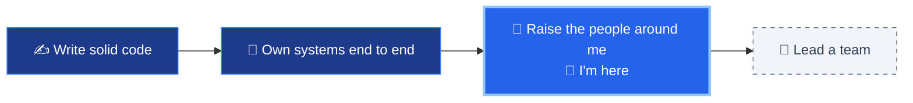

<div align="center">


<a href="https://linkedin.com/in/eycwang"></a>
<a href="mailto:ethan.W9611@outlook.com"></a>


</div>

## 👋 Hey, I'm Ethan

I'm a software engineer in Bellevue, WA, and I've spent 7+ years building full-stack products, distributed backends, and AI systems. What keeps me in this work isn't any one language or framework. It's taking a messy, important problem, owning it from the first sketch to the late-night fix, and watching it turn into something people rely on without thinking about it.

These days that mostly means AI: building tools that help people judge whether content is original, fair, and safe, and making sure the models behind those tools can show their work.

```ts
const ethan = {
  role:        "Senior Software Engineer",
  basedIn:     "Bellevue, WA · Pacific Northwest",
  enjoys:      ["owning problems end to end", "making messy systems calm", "keeping AI honest"],
  fluentIn:    ["Java", "Python", "TypeScript", "SQL"],
  growingInto: "engineering leadership",
  offline:     "hiking the Cascades 🏔️",
  askMeAbout:  ["idempotent consumers", "RAG that cites its sources", "a good trail near Seattle"],
};
```

---

## 💙 What I love building

<table>
<tr>
<td width="33%" valign="top">

### 🖥️ Products people enjoy

I love the moment a tool goes from *"I have to use this"* to *"I want to use this."* That usually comes down to a hundred small details in React and Next.js that nobody notices, because they just work.

</td>
<td width="33%" valign="top">

### ⚙️ Systems that stay calm

Queues, retries, idempotency, caching: the plumbing nobody sees until it breaks. I get real satisfaction from making a busy system boring, predictable, and easy to sleep through.

</td>
<td width="33%" valign="top">

### 🤖 AI you can trust

LLMs are powerful and sometimes confidently wrong. The part I enjoy is the retrieval, evaluation, and guardrails that turn a cool demo into something people can actually depend on.

</td>
</tr>
</table>

---

## 🌱 Where I'm growing

For most of my career, growth meant writing better code and owning bigger systems. Now it means something different: **helping the people around me do their best work.** I'm growing toward engineering leadership, and I'm practicing it on purpose.



**What I'm practicing right now**

- [x] Mentoring engineers, and writing code reviews that teach instead of just block
- [x] Leading system design discussions and staying steady during incident response
- [x] Partnering closely with ML engineers on hard performance and quality tradeoffs
- [ ] Setting technical direction for a whole team, not just a single service
- [ ] Coaching engineers into owners, with real career conversations
- [ ] Turning a fuzzy goal into a roadmap a team actually believes in

> The lead I want to be: someone who gives clear context, protects focus, and gives the credit away.

---

## 🏔️ Off the keyboard

Living in the Pacific Northwest means the mountains are never far away, so on weekends I'm usually on a trail somewhere in the Cascades. It's how I reset, and a surprising number of my best ideas show up around mile three.

Hiking and engineering have more in common than I expected:

| 🥾 On the trail | 💻 In production |
|:--|:--|
| Pack for the weather you don't expect | Design for failure: retries, timeouts, fallbacks |
| Turning back early is a skill, not a defeat | Roll back fast. Ego is not a deploy strategy |
| The view comes after a lot of boring switchbacks | Big results come from steady, unglamorous work |
| Know where you are before picking where to go | Measure before you optimize |
| Nobody gets left behind | Nobody on the team gets left behind either |

---

## 🧭 How I like to build

- **Own the outcome, not the ticket.** If I built it, I'm on the hook when it breaks, and I like it that way.
- **Assume every message arrives twice.** Idempotency is cheaper than an apology.
- **Measure, then tune.** Traces and p95s settle arguments that opinions start.
- **An AI answer without a source is a guess.** Retrieval and evals come before demos.
- **Leave the team faster than I found it.** Reviews, docs, and mentoring are part of the job.

---

## 🧰 Tech stack

<!-- stack:start -->
| Area | Stack |
|:--|:--|
| **💻 Languages** |        |
| **🎨 Frontend** |     |
| **⚙️ Backend & APIs** |       |
| **🤖 AI Engineering** |            |
| **🌊 Data & Streaming** |     |
| **🗄️ Databases** |     |
| **☁️ Cloud & DevOps** |           |
| **🧪 Testing & Observability** |        |
<!-- stack:end -->

<div align="center">

<br/>

**Always happy to talk about distributed systems, trustworthy AI, growing into leadership, or a good trail near Seattle.**
<br/>
[LinkedIn](https://linkedin.com/in/eycwang) · [Email](mailto:ethan.W9611@outlook.com)


</div>
