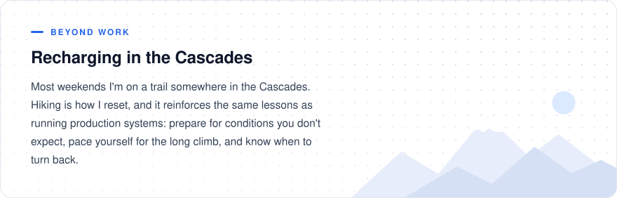

<!-- Generated by scripts/build-readme.mjs from scripts/readme-content.mjs. Edit the content there, then run: node scripts/build-readme.mjs -->

  <picture>
    <source media="(max-width: 767px)" srcset="https://raw.githubusercontent.com/eycwang/eycwang/main/assets/readme/hero-mobile.svg">
    
  </picture>

  
  

  <picture>
    <source media="(max-width: 767px)" srcset="https://raw.githubusercontent.com/eycwang/eycwang/main/assets/readme/about-mobile.svg">
    
  </picture>

  <picture>
    <source media="(max-width: 767px)" srcset="https://raw.githubusercontent.com/eycwang/eycwang/main/assets/readme/focus-mobile.svg">
    
  </picture>

  <picture>
    <source media="(max-width: 767px)" srcset="https://raw.githubusercontent.com/eycwang/eycwang/main/assets/readme/leadership-mobile.svg">
    
  </picture>

  <picture>
    <source media="(max-width: 767px)" srcset="https://raw.githubusercontent.com/eycwang/eycwang/main/assets/readme/principles-mobile.svg">
    
  </picture>

  <picture>
    <source media="(max-width: 767px)" srcset="https://raw.githubusercontent.com/eycwang/eycwang/main/assets/readme/beyond-mobile.svg">
    
  </picture>

  <picture>
    <source media="(max-width: 767px)" srcset="https://raw.githubusercontent.com/eycwang/eycwang/main/assets/readme/stack-mobile.svg">
    
  </picture>

